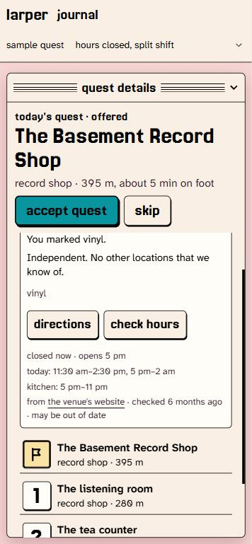
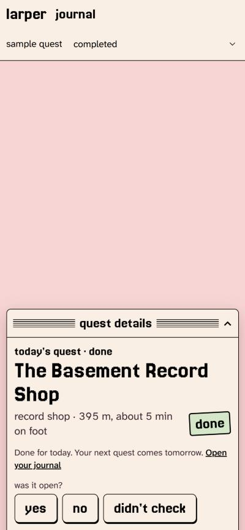

# Session report, 2026-11-16 (evening)

Follows `session-2026-11-16.md`. Same rules: nothing merged, deployed, or run against a
live system; migrations ran only on a throwaway local Postgres; no third-party data
was imported anywhere. Implementation by Sonnet subagents in their own worktrees;
every PR had an independent review.

The instructions for this session arrived cut off partway through Phase 2, step 5
("keep it off by default behind…"), and no Phase 3 was received. Phases 1 and 2 are
done as written; the cut-off sentence was read as "behind the existing flag".

## Pull requests

| PR | Head | CI | Review | What to look at |
|---|---|---|---|---|
| [#87](https://github.com/MatthewJiang168977/Larper/pull/87) quest screen | `5d58df3` | Web green; the two image jobs red until the branch is updated from `main` | Approved | Desktop dock now starts open. Description corrected about the phone sheet. |
| [#90](https://github.com/MatthewJiang168977/Larper/pull/90) trust gate | `e96c697` | **All green**, including Database tests | Approved at `c0ec05e`; `e96c697` only merges `main` | Blocklist additions; **migration 0017** |
| [#91](https://github.com/MatthewJiang168977/Larper/pull/91) plans | this PR | docs | — | Recruiter story removed |
| [#92](https://github.com/MatthewJiang168977/Larper/pull/92) hours sources | `56b61c4` | docs (one stale red job from before #89) | — | **Three decisions for you**, at the end of the doc |
| [#93](https://github.com/MatthewJiang168977/Larper/pull/93) Go hours parser | `feced52` | All green | Approved | Nothing calls it yet |
| [#94](https://github.com/MatthewJiang168977/Larper/pull/94) web hours UI | `2b2ad55` | Web green; image jobs red until #87 merges and the branch is updated | Approved | Copy; stacked on #87 |
| [#95](https://github.com/MatthewJiang168977/Larper/pull/95) API hours | `615034d` | Running at the time of writing | No code findings at `8390676`; approval waits on the database run | **Migration 0018**; stacked on #90 |

Pushed without a PR: `feat/m9-quest-facts` (the two local-only M9-plan commits). It
merges into `main` without conflicts, and its plan text is already on `main` through
#79, so the branch can simply be deleted when you're ready.

## Phase 1

1. **#87: the desktop dock starts open.** Set as the sheet's initial state, so nothing
   animates, is announced, takes focus, or marks the first-visit hint as seen. Phones
   are unchanged. The PR description now says the phone sheet is flush with the bottom
   edge at peek.
2. **#90:**
   - Added to the blocklist: day care and preschools; funeral homes and crematoria;
     courthouses and jails; casinos, sportsbooks and bingo halls. None of these reach
     the database through the loader today, so this is a guard.
   - Kept allowed, with tests: B&Bs, inns, hostels, holiday rentals, guest houses
     (`private_lodging` was removed from the residential group) and campus
     attractions. In the data a campus museum or library never carries
     `college_university`; only the college itself does.
   - "Not my thing" still counts as a dislike.
   - `docs/milestones/M9-plan.md`: M9's future migrations renumbered to 0019–0022,
     after `0017_saved_places` and `0018_place_hours`, with a dated note.
   - Controller test added for `GET /saved-places`.
3. **#91:** the recruiter story is out of the committed docs, along with two "job
   hunting" mentions and one "for recruiters" line. It remains in this branch's
   earlier commits and in the PR's history on GitHub; a squash merge keeps it out of
   `main`, but it can't be fully removed from a public PR.
4. **M9 branch pushed** as-is.

## Phase 2: opening hours

**Decision doc (#92).** Recommended now: check-in confirmations, hand-verified hours
for the focus neighborhoods, and the venue's own website under stated crawl rules
after measuring coverage. Not now: OpenStreetMap, because a separate table does not by
itself avoid share-alike under the OSMF guidelines, and matching OSM venues to ours is
close to a case the guidelines call "not covered". The doc describes the
publish-under-ODbL route that would make it usable. NYC Open Data has no hours for
ordinary venues but good closure signals.

**Data model (#95, migration 0018).** `place_hours_facts`: every fact has a source, a
source URL, a fetch time and a confidence. Schedules cover overnight hours, split
shifts, kitchen and bar hours, and dated or yearly closures. A place with no schedule
is "unverified", never closed. The API role can insert and read only. The ingest role
gets no grant until a source is approved.

**Parser and "is it open?" (#93, Go).** OpenStreetMap `opening_hours` and schema.org
hours into one normalized schedule; evaluation in New York wall-clock time across both
daylight-saving changes. Anything it can't fully understand evaluates to "unknown"
rather than a guess. 145 evaluation cases and 115 parse cases, plus fuzzing.

**One set of tests for two languages.** The API evaluates the same schedules in
TypeScript and runs the Go package's test file, byte for byte. The first run failed:
the two implementations disagreed in 12 places (holidays, how strict validation is,
how midnight is shown). All fixed before anything shipped.

**"Was it open?" (#94 web, #95 API).** One optional question after a real check-in:
yes / no / didn't check. Stored as a fact with source `check-in`. Shown later as
"confirmed open by N people, most recently tuesday evening". Analytics gets one event
with one property, the answer; no place id.

**UI (#94).** "hours unverified, check before you go" plus the venue's website and
phone; with hours on file: open or closed now, today's hours, the source and its age.

| hours on file | after a check-in |
|---|---|
|  |  |

**Evening rule (#95).** Now reads real schedules; still off by default.

## Merge order from here

1. #86, then #87 (update each from `main` first, as in the earlier plan). Close #80.
2. #94: after #87 merges it retargets to `main`; update from `main`, wait for green,
   merge. Safe before the API: it asks the question only when the API supports it.
3. #90, then #95 (retargets to `main`; update, wait for green). Each has a migration;
   apply 0017 then 0018 before the new API pods start. Deploying is a live change and
   needs your approval.
4. #93, #92, #91 in any order.

## Decisions made on your behalf

1. **The evening rule with hours:** when on, in the evening, a place is offered only
   if its schedule says open at that moment. Unknown and closed are both left out.
2. **"Didn't check" is stored** so the question isn't asked again; it never counts.
3. **A confirmation count of 1 is shown.** That reveals someone checked in there on,
   say, a Tuesday evening. Raise the minimum if you'd rather.
4. **The demo account is never asked** "was it open?".
5. **The question is not optimistic:** "thanks, noted" only once the answer is stored.
6. **The web hides a venue link whose address isn't http or https**, including the
   existing Website and Instagram links. A website stored without a scheme used to be
   a broken link and is now no link.
7. **Holiday and date rules written before a weekday rule** make the parser answer
   "unknown" instead of choosing a reading.
8. **Unmentioned major holidays evaluate to "unknown"** (1 January, 4 July,
   Thanksgiving, 25 December).
9. **Gambling:** arcades, escape rooms and lottery vendors stay allowed.
10. **Merged `main` into `api/trust-gate` and `api/place-hours`** to get a database
    run in CI. No rebase, no force-push.
11. **Copied `apps/web/.env.local` into one worktree** to look at the new UI in the
    design lab, then deleted the copy.
12. **Worktrees from both sessions removed.** Branches remain, locally and on origin.

## Decisions only you can make

1. The three in #92: approve check-ins, hand verification and venue websites as
   sources; what to do about OpenStreetMap; who answers the open licence questions.
2. All merges, and applying migrations 0017 and 0018.
3. The minimum count before "confirmed open by N people" is shown.
4. The copy in #94.
5. Phase 3, which didn't arrive.

## Unfinished

- #95's database specs: check the CI run on `615034d`.
- #95 review minors, not done: a check that an observation always has a user; a size
  cap on a schedule's date list; `nextChange` gives a time with no day.
- #87 and #94 need updating from `main` to turn their image jobs green (after #86).
- A flaky test predating this work: "starts the map only once the sheet is on screen"
  in `quest-home.test.tsx` uses a real 50 ms timer.
- The first-quest performance baseline is still not written down in the repo.

Prompt to continue, on any model:

> In C:\dev\larper, follow CLAUDE.md. Do not merge or deploy anything.
> 1. Report the CI status of PRs #87, #90, #93, #94 and #95 on their current head
>    commits. For any PR whose base has merged, check out its branch in a new worktree
>    under C:\dev\larper-wt, run `git merge origin/main`, push, and report again when
>    CI finishes. If a database spec fails on #95, fix it on `api/place-hours`.
> 2. On `api/place-hours`: in migration 0018 add
>    `CHECK (kind <> 'observation' OR user_id IS NOT NULL)`, and in
>    apps/api/src/hours/schedule.ts make `validateSchedule` reject more than 400
>    `dates` entries; add tests; run the API tests against a local throwaway Postgres
>    as .github/workflows/ci.yml's db job does.
> 3. In apps/web/components/quest/quest-home.test.tsx make "starts the map only once
>    the sheet is on screen, a frame later" use fake timers. Open a PR off main.
> 4. Remove the worktrees you created and tell me each PR's head commit and CI status.
