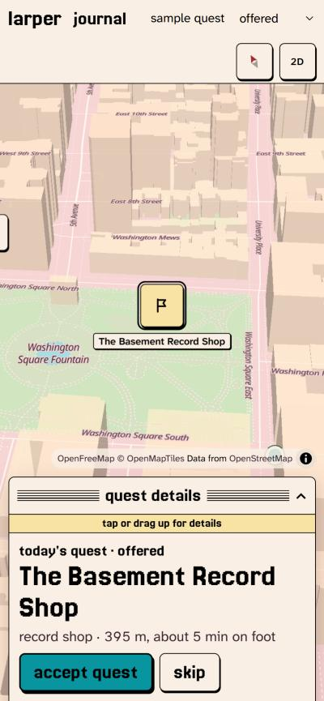
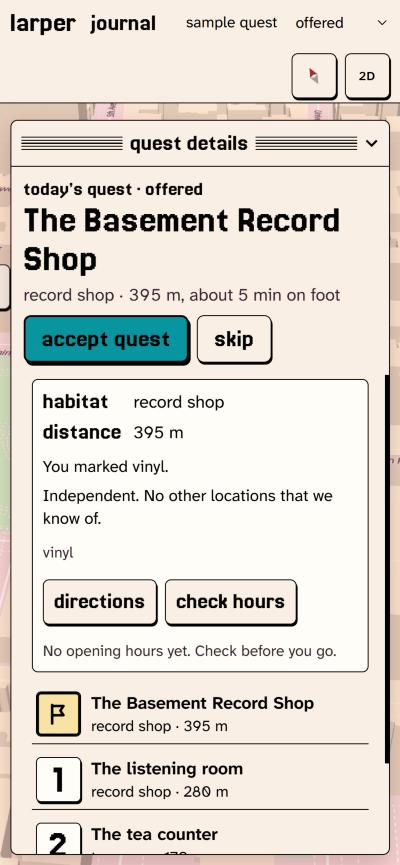
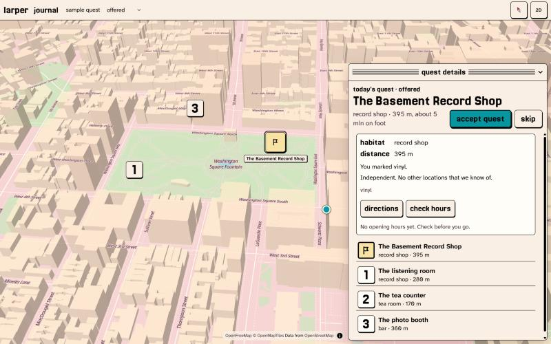

# Session report, 2026-11-16

Lead: Claude (Fable). Implementation, recon and test writing: Sonnet subagents, each in
its own worktree. Nothing was merged, deployed, or run against a live system. No
migration ran anywhere except a throwaway local database.

## Pull requests

CI status as of the end of the session. "Image jobs red" means only "Postgres image"
and/or "Database tests" fail, for the unrelated reason described under step 0 of the
merge plan.

| PR | Head | CI | What changed today | What to review |
|---|---|---|---|---|
| [#87](https://github.com/MatthewJiang168977/Larper/pull/87) quest screen | `a9c2d80` | Web jobs green; image jobs red | Review fixes pushed (hint, handle name, constants, restored tests, dead code). Comment with screenshots. Independent reviewer approved this commit. | The two design questions below; the copy changes. |
| [#89](https://github.com/MatthewJiang168977/Larper/pull/89) CI image | `d6b77ea` | Database tests **green** (was red); Postgres image red until #88 | New. One line: `pgvector/pgvector:0.8.0-pg17` → `0.8.7-pg17`. | That you're happy pinning that tag. |
| [#90](https://github.com/MatthewJiang168977/Larper/pull/90) trust gate | `4c1b430` | API, Go, lint green; image jobs red, so database specs haven't run in CI | New. Eligibility gate, saved places (**migration 0017**), Not today proof. | Threshold, blocklist, migration and grants, "not my thing". |
| #91 plans (this PR) | — | docs only | The industry-ready plan and this report. | The plan's open decisions. |
| [#84](https://github.com/MatthewJiang168977/Larper/pull/84), [#85](https://github.com/MatthewJiang168977/Larper/pull/85), [#86](https://github.com/MatthewJiang168977/Larper/pull/86) | `79011e8`, `18f8a31`, `5499fe2` | green (runs from before 2026-11-16) | Not changed. | Merge order below. |
| [#88](https://github.com/MatthewJiang168977/Larper/pull/88) Dependabot | `08059d6` | Postgres image green; Database tests red until #89 | Not changed. Needed with #89. | — |
| [#80](https://github.com/MatthewJiang168977/Larper/pull/80) old affordances | `50598b8` | green | Not changed. | Close as superseded after #87 merges. |

The repository is **public**. The plan in this PR is blunt about the product and
includes the "recruiter story"; decide whether you want that in a public repo before
merging. It is already visible on the PR.

## Workstream A: the quest screen (#87)

### Review result

An independent reviewer and my own read both found **no blockers**. Checked against
#86 line by line:

| Behaviour | Result |
|---|---|
| Accept, Skip, Not today and its reasons | Preserved. Same labels, same actions, same reason values. The duplicate phone/desktop copies of Skip and Not today became one button. |
| "I went": geofence, stamp, demo simulated check-in | Preserved. Logic untouched; the stamp only changed class. |
| Directions, Website, Call, Hours | Preserved. Same hrefs, conditions, `rel` and `target`. |
| Lead selection ↔ map pins | Preserved both ways; numbering unchanged. |
| Peek and full snaps | Preserved: drag, tap, arrow keys, Escape with focus return, `aria-expanded`. |
| Desktop dock | Docked right at 520 px. Pins and the map credit are not covered (measured at 1440 px: credit ends at x=900, dock starts at x=910). The dock still opens and collapses on desktop, as on phones. |
| Loading, empty, error, location, surveying | Preserved. Same roles, copy and retry actions. |
| `/design-lab/quest` | 404 in production (`assertDesignLab`, unit-tested); the fixture never calls the real API. |
| Touch targets | Every control in the new CSS is at least 44×44. Only the map credit's inline links are smaller (third-party control, unchanged). |
| Contrast | No failures. Lowest pair: ink on the primary button's hover colour, 4.67:1. |
| Reduced motion | No new animation added; the place fade and distance count-up were removed; the sheet spring still honours the setting. |

### Fixed on the branch

1. **First-visit hint.** It was marked seen in the same tick it appeared. Now the mount
   effect only reads the key; the key is written when the sheet is opened (tap,
   keyboard or drag all go through `go("full")`). Checked in the browser: key absent
   before opening, set after. Seven tests cover first visit, reload without opening,
   opening, reload after opening, keyboard, collapse and storage failure.
2. **Handle name.** The handle showed "Quest details" but was named "Show more about
   this place", so voice control couldn't target it by its visible text. Now "Quest
   details, show more / show less".
3. **Dock constants.** `1024` and `530` were hard-coded in two files. Now
   `DOCK_MIN_WIDTH_PX` and `DOCK_RESERVED_PX` in `quest/dock.ts`.
4. **State card** falls back to `role="group"` so its label always applies.
5. **Tests restored** that the restyle had dropped: the phone map inset staying put
   when the sheet opens, the desktop reservation at both snaps and at the 1023/1024
   boundary, the quest row's flag, `formatDistance(306_412)`.
6. **Dead code removed:** `ui/blur-fade.tsx`, `ui/number-ticker.tsx` (no imports left).

### Left for the owner (not changed)

- **At peek on a phone, the sheet has no bottom inset.** The description says the sheet
  sits 10 px from the edges; that holds at the sides and at full, but at peek the
  window runs off the bottom of the screen (measured: peek content ends at y=844 on an
  844 px screen), so there's no bottom border. It looks like a normal bottom sheet and
  nothing is clipped. Making it a floating window at peek means animating height
  instead of translating, which is a design change, so I left it.
- **The desktop dock starts collapsed.** With a 520 px dock there's room to start open.
  A product choice.
- **Copy changed with the restyle:** "Larper" → "larper", "Journal" → "journal",
  lowercase buttons, new "habitat" and "distance" rows that repeat the peek line.
- **Phone leads** are now a vertical list instead of a sideways-scrolling row.
- Tall notices on desktop can overlap the dock; the map shifts by a few pixels on
  first measure. Both minor.

### Screenshots

`/design-lab/quest`, sample quest, offered:

| 390 px, peek | 390 px, full | 1440 px |
|---|---|---|
|  |  |  |

## Merge plan for the redesign stack

The repo allows squash merges and deletes head branches on merge. `main` is not
protected. I simulated the whole sequence locally (`git merge-tree`, no refs changed):
**every step is conflict-free, and the final tree is byte-identical to the
quest-screen branch.** Consecutive PRs in the stack share no files, which is why.

One thing to know first: `web/larper-os-journal` does not contain the latest
`web/larper-os-landing` (it's missing the merge of #82 and #83). That's harmless here
because #85 touches none of those files, but it's why step 2 merges `main` in rather
than assuming the branch is current.

Each merge to `main` is a Vercel production deploy. Doing all four in one sitting
means four deploys a few minutes apart; the landing page, journal and onboarding each
go live before the quest screen does. Every intermediate state was a green CI head on
its own PR, so that's safe, but don't stop halfway for long: after #86 the onboarding
is Larper OS and the quest screen it leads to is still the old look.

**0. First, make CI green: merge #88 and #89.** Since 2026-11-16 the "Postgres image"
and "Database tests" jobs fail on every branch, because the PostGIS apt package no
longer loads in the pinned Postgres images. #88 (Dependabot, base image digest) fixes
the first and #89 (pgvector service image tag) the second. Each is red on the other's
job until both are in; neither touches the web app or deploys anything. The redesign
PRs are web-only, so their red jobs are not about them, but merge these two first and
every later step can wait for a fully green run.

Until #88 merges, do not rebuild the stack's Postgres image: it would build with a
PostGIS that doesn't load.

For each PR, in order:

**1. #84 landing → main**
- Update the branch from `main` (it now has #88 and #89), wait for CI, then squash
  and merge. GitHub deletes the branch
  and retargets #85 to `main`.
- Watch the Vercel production deploy finish; open playlarper.com signed out.

**2. #85 journal**
- Confirm its base is now `main` (if not: `gh pr edit 85 --base main`).
- Update the branch so its diff shows only the journal:
  ```
  git fetch origin
  git switch web/larper-os-journal && git pull
  git merge origin/main
  git push
  ```
- Expected: no conflicts. Wait for CI on the new head, check the PR's Files tab shows
  only the 6 journal files, then squash and merge.

**3. #86 onboarding**: the same, with `web/larper-os-onboarding` (6 files expected).

**4. #87 quest screen**: the same, with `web/larper-os-quest-screen` (expect the
quest, map and design-lab files only). After the deploy, check on a phone: accept,
open the sheet, pick a lead, check in.

**If a merge of `main` does conflict** (it shouldn't unless a branch changes in the
meantime): every conflicting file will belong to a PR that already merged, never to
the PR you're updating, because the PRs share no files. So take `main`'s version of
each one:
```
git checkout --theirs -- <file> && git add <file>
```
and commit. If a conflict appears in one of the PR's *own* files, stop: something
else changed that file on `main`.

Use "Update branch" in the GitHub UI instead of the commands if you prefer; it does
the same merge. Don't rebase: these branches contain merge commits and a rebase will
replay conflicts that the merges already resolved.

**5. After #87 is merged: close #80** as superseded. It conflicts with the new
`main` in `quest-home.tsx`, `quest-sheet.tsx`, `quest-sheet.test.tsx` and
`state-card.tsx`. Its hint, handle affordance, hover and focus states all exist in
#87 in Larper OS form. What does *not* carry over, by design: the pressed-shadow
styles for the old paper buttons and pins, and the `quest-inline` styling on the demo
notice's buttons (`demo-notice.tsx` is untouched by the redesign, so check it still
looks right against the new screen). I have not closed it.

## Workstream C: trust gate

PR #90, branch `api/trust-gate`, off `main`. Full detail is in the PR description.

- **Gate** (`apps/api/src/quests/eligibility.ts`), applied before scoring; deck cache
  key bumped to `v4`.
  - Confidence ≥ 0.7. Measured on the local Overture extract (566,086 rows, 80,001
    loaded): confidence clusters at 0.55, 0.65, 0.75, 0.77, 0.92, 0.99. A floor of 0.7
    drops the two lowest clusters, 9.7% of loaded places. 0.8 would drop 20%.
  - Category blocklist using Overture's real names. Removes 262 loaded places, nearly
    all places of worship; the taxonomy already rarely tags clinics, schools or
    offices, so this is mostly a guard for later.
  - Near-duplicates (same normalized name within 50 m): removes 211.
  - Unknown hours, 18:00 to 06:00 New York: built and tested across both 2026 DST
    changes, **off by default** (`QUEST_GATE_EVENING_UNKNOWN_HOURS`).
- **Accept saves the place**: migration `0017_saved_places`, same transaction,
  idempotent; `GET /saved-places` for the caller only.
- **Not today is not a dislike**: already true; now pinned by API tests and a Go test
  that the taste vector is unchanged bit for bit.
- **Tests**: 373 API tests passed locally against a throwaway Postgres (migration up,
  down, up clean), Go tests clean. The database specs have **not** run in CI yet
  because of the image problem above.

**Independent review of `4c1b430`:** no blockers or majors found in the code. It
checked the DST instants by hand, found no path that reaches the deck without passing
the gate, and confirmed SQL and TypeScript use the same blocklist constant and the
same float comparison. Its verdict is "changes requested" for one procedural reason:
the database specs have not run in CI on this commit (they did pass locally for the
implementer, which the reviewer could not repeat). It will approve once that run is
green.

Blocklist edges the reviewer raised for you: possibly too broad are
`private_lodging` (B&Bs), `college_university` (attractions on a campus),
`educational_service` and `public_utility`; possibly missing are day care and
preschools, funeral homes, courthouses and jails, casinos.

## Decisions made on your behalf

1. **The evening-hours rule ships switched off.** There is no hours data, so on it
   would mean no new quests from 6pm to 6am for everyone. Reversible with one
   environment variable.
2. **"Evening" is 18:00 to 06:00 New York time.** You said "after 6pm"; I added the
   6am end so the rule doesn't lapse at midnight.
3. **"Not my thing" still counts as a dislike.** It is the one reason given after Not
   today that moves taste. One line to change (`REASONS_THAT_COUNT_AS_DISLIKE`).
4. **Confidence floor 0.7**, from the data above.
5. **The `education` category root is not blocked**, because Overture files libraries
   under it. Schools are blocked by their own names.
6. **Saved places: the API can insert and read, not delete.** That matches the
   existing rule that the API role never deletes. Removing a saved place will need a
   decision later (a soft-delete column, or a narrow function).
7. **The demo reset clears the demo account's saved places**, like its quests.
8. **Left the desktop dock collapsible and the phone peek flush with the bottom
   edge** on #87. Both are design choices in a redesign you called final.
9. **Did not bypass the pre-commit secret scan.** It needs Docker, which wasn't
   running, so I started Docker Desktop. It is still running.
10. **Opened #89** (CI image tag) although you didn't ask for it: without it no PR can
    show a green database run.
11. **Screenshots are committed in the docs PR** under
    `docs/plans/session-2026-11-16/` (about 160 KB) so the PRs can link to them.
12. Created worktrees under `C:\dev\larper-wt\`: `quest-screen`, `trust-gate`,
    `docs-plan`, `ci-pg`. Copied `apps/web/.env.local` into the `quest-screen`
    worktree (untracked, ignored) to run the design lab locally. Your main checkout
    on `feat/m9-quest-facts` was not touched.

## Decisions only you can make

1. Merging anything. Every PR here touches the web app, a migration, CI, or is a
   product decision.
2. Closing #80 after #87 merges.
3. Whether "not my thing" is a dislike.
4. The blocklist's edges: cemeteries, community centres, pharmacies, dispensaries and
   hostels are currently allowed.
5. Whether the phone sheet should float 10 px above the bottom edge at peek, and
   whether the desktop dock should start open.
6. When to apply migration 0017 and deploy the API (a live change; needs your
   approval and must go before the new pods).
7. What to do with the two unpushed M9-plan commits on `feat/m9-quest-facts`
   (`810220c`, `8f4a8ef`). They exist only on this machine.
8. `AGENTS.md` and `.codex/` are untracked in the main checkout.
9. The open decisions in the industry-ready plan (D1 to D7).

## Unfinished, and how to continue

- The database specs for #90 have not run in CI.
- No controller-level test for `GET /saved-places`.
- The NYC-dataset comparisons in `candidates.db.spec.ts` were adjusted but can't run
  without the full dataset.
- A flaky test exists on #87's branch and before it: "starts the map only once the
  sheet is on screen" in `quest-home.test.tsx` uses a real 50 ms timer and failed once
  under load.
- The 6.33 s performance baseline is not written down anywhere in the repo.

Prompt to continue tomorrow, on any model:

> In C:\dev\larper, follow CLAUDE.md. Do not merge or deploy anything.
> 1. Check whether #88 and #89 are merged. If they are, in the worktree
>    C:\dev\larper-wt\trust-gate run `git fetch origin && git merge origin/main`,
>    push, wait for CI on PR #90, and report whether "Database tests" passed. If a
>    database spec fails, fix it on that branch and push.
> 2. On PR #90, add a controller test for GET /saved-places next to
>    apps/api/src/quests/quests.controller.spec.ts, following its style: it returns
>    the service's rows for the authenticated user and requires auth.
> 3. In C:\dev\larper-wt\quest-screen, make the test "starts the map only once the
>    sheet is on screen, a frame later" in apps/web/components/quest/quest-home.test.tsx
>    use fake timers instead of a real 50 ms wait. Run the web tests three times.
>    Push to PR #87 only if #87 hasn't merged; otherwise open a new PR off main.
> 4. Run lint, typecheck and tests for each app you touched, and tell me each PR's
>    head commit and CI status.
